# Self-hosted GitLab CI/CD on Proxmox

A complete CI/CD platform built from scratch in a home lab: **GitLab CE with a container registry, a Docker-executor runner, and a separate deploy target**, provisioned with **Terraform** and configured with **Ansible**, running a multi-stage pipeline that lints, tests, builds, scans, and deploys a Flask app to staging and (manually) to production.

The production pipeline runs on the self-hosted GitLab in this repo ([`.gitlab-ci.yml`](.gitlab-ci.yml)). GitHub does not run GitLab pipelines, so a [GitHub Actions workflow](.github/workflows/ci.yml) mirrors the build, test, and scan stages here.

## What this demonstrates

| Area | What is in the repo |
|---|---|
| **GitLab CI** | `workflow:rules`, merge request pipelines, `rules:changes`, DAG ordering with `needs`, `extends` and hidden jobs, `include` (local and GitLab templates), caching keyed on dependency files, JUnit and coverage reports, `environment:` with a manual production gate |
| **Security scanning** | Trivy (filesystem and image), gitleaks, and GitLab SAST |
| **Infrastructure as code** | Terraform (`bpg/proxmox`) for the LXC containers, including `import` blocks that adopted hand-built containers without rebuilding them |
| **Configuration management** | Ansible roles for hosts files, Docker, GitLab CE with the registry, and the runner |
| **Containers** | Non-root image on a slim base, built and pushed to a private registry |
| **Debugging** | A [troubleshooting log](docs/setup.md#troubleshooting-log) of real problems with root causes |

## Architecture

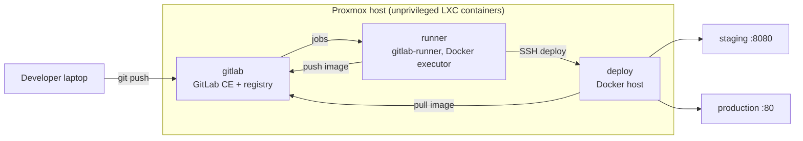

## Pipeline

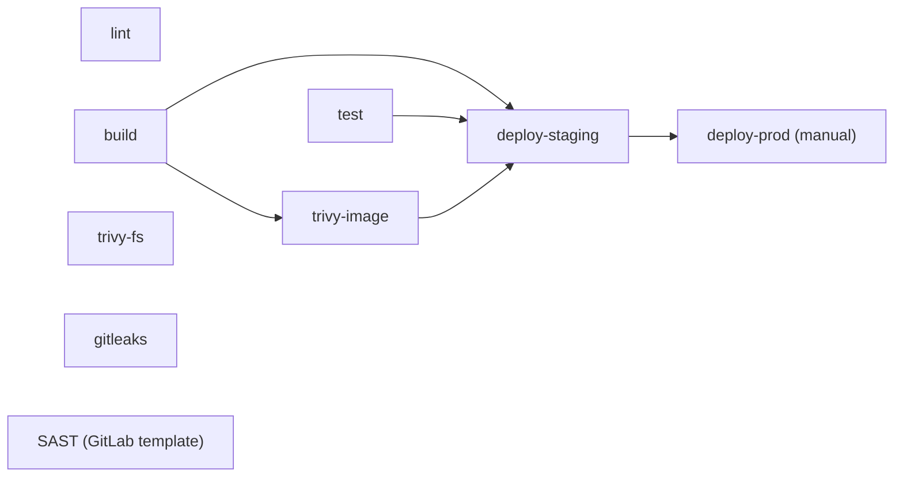

`lint`, `build`, `test`, `trivy-fs` and `gitleaks` start immediately (`needs: []`). `trivy-image` waits only for `build`, and `deploy-staging` waits for `build`, `test` and `trivy-image`. That is a DAG with `needs`, not stage-by-stage execution. The GitLab SAST template job has no `needs`, so it runs in its stage after the earlier stages finish. Deployments happen only from the default branch, and production needs a manual click.

## Screenshots

**Pipeline runs.** Recent pipelines on `main`, all stages passing.

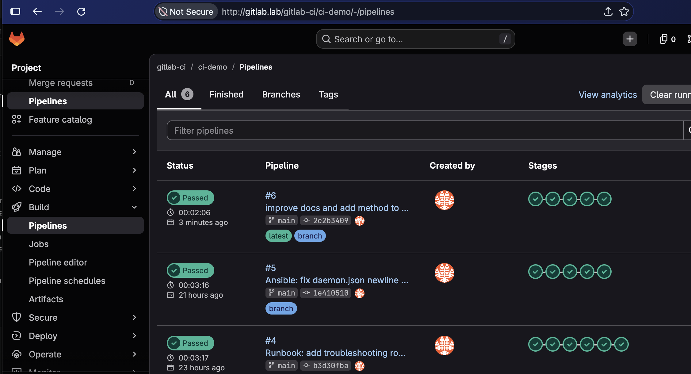

**Job dependencies (the `needs` DAG).** Jobs run as soon as their dependencies finish, not stage by stage.

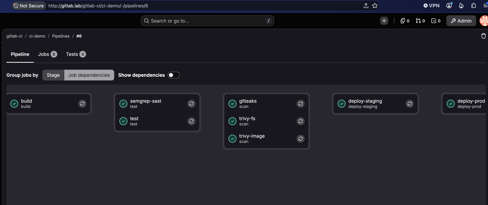

**Environments.** Staging deploys automatically from `main`. Production is a manual gate.

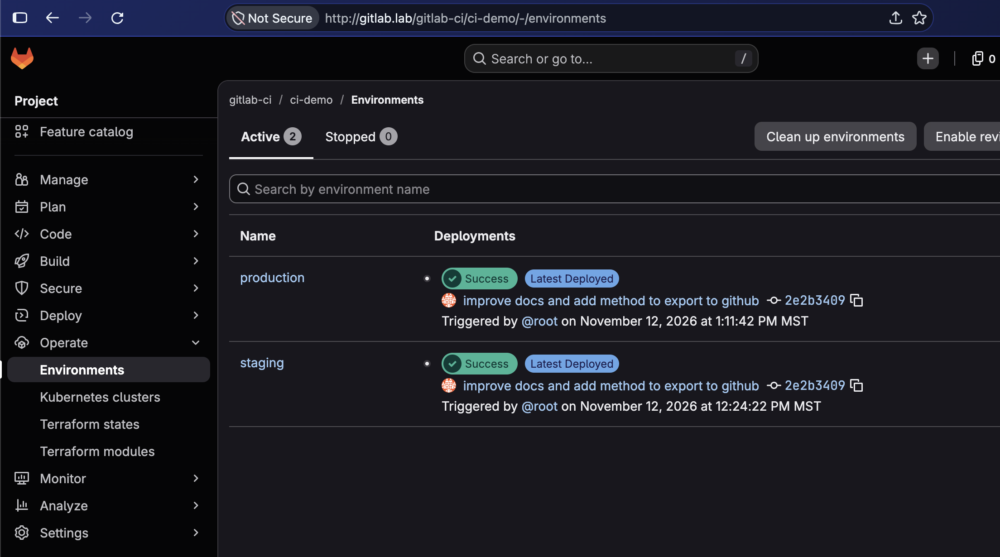

**Production deployment history,** with redeploy and rollback actions.

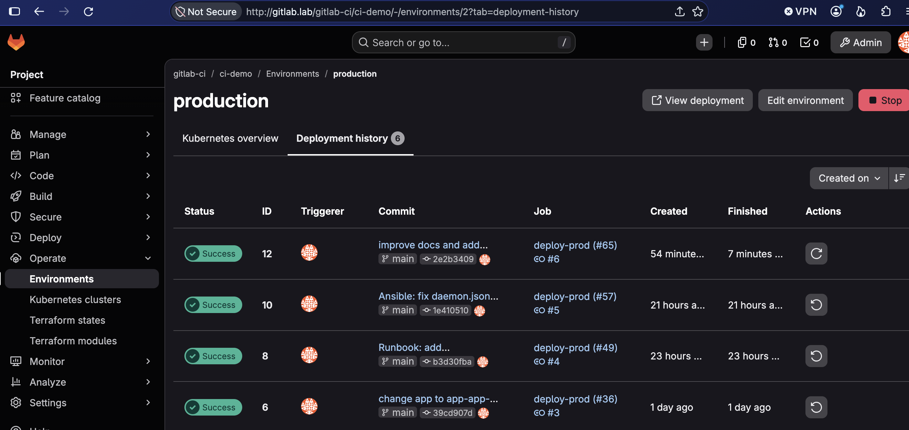

**Container registry.** Images built by the pipeline, tagged by commit SHA and `latest`.

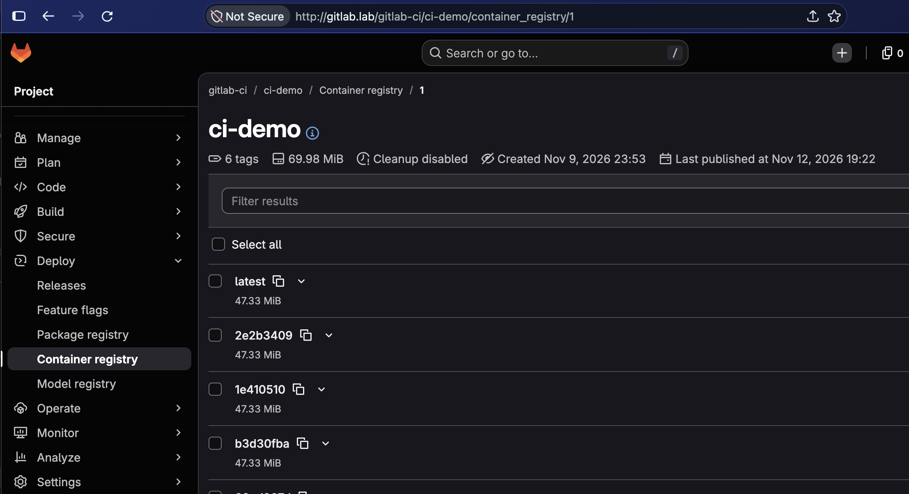

**Security scan.** Trivy filesystem scan of the pinned dependencies.

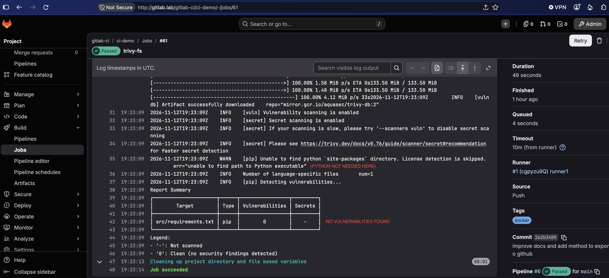

**The deployed application,** served from the deploy container.

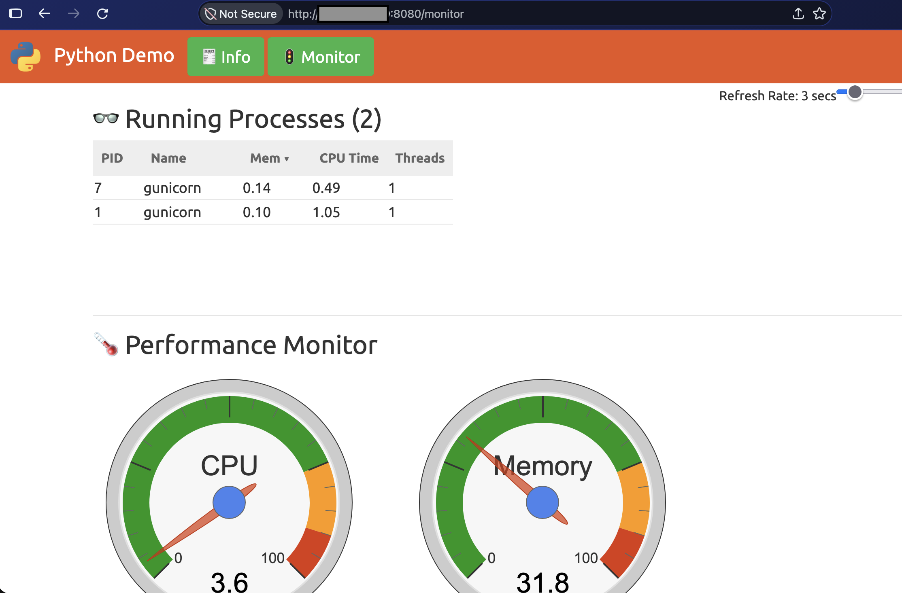

**The runner,** a Docker-executor runner registered to the GitLab instance.

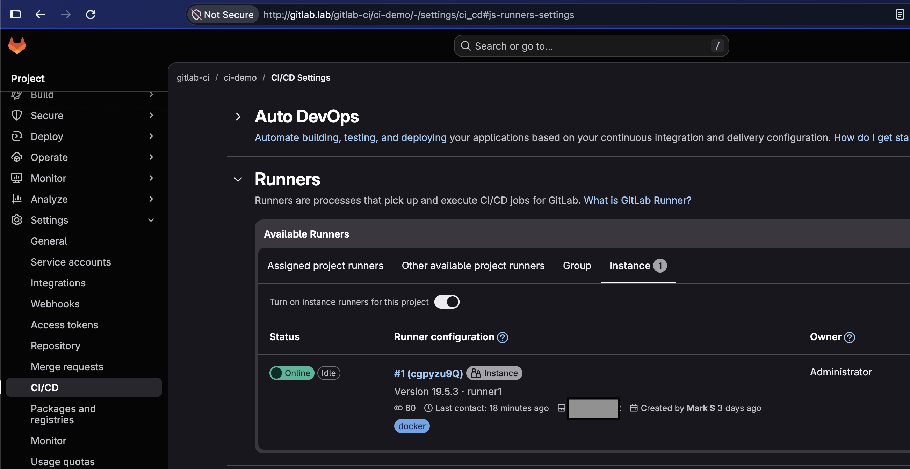

**The infrastructure,** three LXC containers on Proxmox, managed with Terraform.

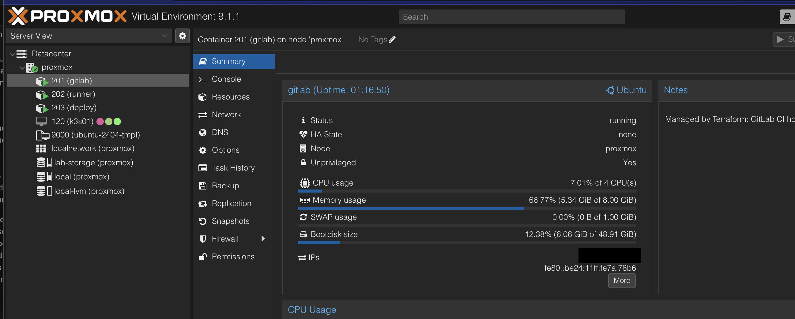

## Repository layout

| Path | Contents |
|---|---|
| [`.gitlab-ci.yml`](.gitlab-ci.yml), [`ci/`](ci/) | The pipeline and its shared job templates |
| [`.github/workflows/ci.yml`](.github/workflows/ci.yml) | GitHub Actions mirror of build, test, and scan |
| [`src/`](src/) | The demo Flask application and its tests |
| [`Dockerfile`](Dockerfile) | Container image for the app |
| [`terraform/`](terraform/) | Proxmox LXC containers |
| [`ansible/`](ansible/) | Node configuration |
| [`docs/setup.md`](docs/setup.md) | Full runbook, with every command, and the troubleshooting log |

## Reproducing the lab

1. Build or adopt the three containers (`gitlab`, `runner`, `deploy`) with [`terraform/`](terraform/). The runbook shows the equivalent `pct` commands.
2. Configure them with [`ansible/`](ansible/): `ansible-playbook site.yml`. Create the runner in the GitLab UI and pass its token through the `GITLAB_RUNNER_TOKEN` environment variable. It is never stored in the repo.
3. Create a project, set the CI/CD variables (`SSH_PRIVATE_KEY` as a File variable, `STAGING_HOST`, `DEPLOY_USER`), and push.

Example addresses in the files use `192.168.50.0/24`. Substitute your own.

## Lab shortcuts and what I would change for production

This is a single-user lab, so some choices trade safety for simplicity:

- **Plain-HTTP registry and GitLab.** Production would use TLS everywhere.
- **Docker socket mounted into build jobs.** Jobs share the runner host's Docker daemon. Production would use rootless builds (for example BuildKit or Kaniko) or isolated, ephemeral runners.
- **Deploys as root over SSH.** Production would use a dedicated, least-privilege deploy user, or a pull-based mechanism such as GitOps.
- **Scanners set to `allow_failure`.** In production, high-severity findings would fail the pipeline.
- **Secrets.** CI variables here are stored in GitLab. Production would use a secrets manager with short-lived credentials.
- **Name resolution.** Hosts-file entries stand in for real DNS.

## Acknowledgements

- The demo web application in [`src/`](src/) is **[python-demoapp](https://github.com/benc-uk/python-demoapp) by Ben Coleman**, used under the MIT license (see [`src/LICENSE`](src/LICENSE)). I changed dependency versions and the container build; the application code and its tests are his.
- I found the app through the [TechWorld with Nana GitLab CI/CD crash course](https://gitlab.com/nanuchi/gitlab-cicd-crash-course), which uses it as its example. The pipeline, infrastructure code, and runbook in this repo are my own work.

## License

My own code and documentation: MIT, see [LICENSE](LICENSE). The application in `src/` keeps its original license ([`src/LICENSE`](src/LICENSE)).
